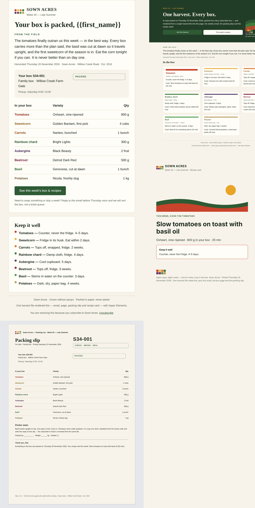

# SOWN — One Harvest, Every Box

**A Hyper Elements template kit for a community-supported agriculture (CSA) farm.**
One harvest file in → a personalised email, a public box page, print-ready packing slips (PDF) and recipe cards out — all four rendered from **one theme and one set of shared components** with [`@hyper-elements/react`](https://hyperelements.dev).

> The point is not "four outputs". It is that each destination gets the job only it can do — and the box a subscriber reads about is provably the same box the packer packs, because it is the same component tree under four different roots.



*Screenshot placeholder: run `npm run render` and `npm run shots` (see below) to generate the real renders, then replace this image. No screenshot in this README is a mock-up claim — if it is pictured, it was rendered.*

---

## The four outputs

| Output | Root | Renderer | Its job |
|---|---|---|---|
| `templates/box-email.tsx` | `<Email>` 600px | `render()` → HTML + plain text | The weekly box letter. Table-safe, no Svg, no remote images — the HarvestMark is a `Grid` of `Column`s, so it survives image-blocking inboxes. `MergeTag` personalises the greeting. |
| `templates/box-page.tsx` | `<Page>` 1100px | `render()` → responsive HTML | The public box page. The lush one: full `Svg` field art, a `Grid` of typed `ProduceCard`s, phone styles, no client-side JavaScript. |
| `templates/packing-document.tsx` | `<Document>` A4 | `render()` → print HTML, `renderPdf()` → PDF | The packing run. `PageHeader`/`PageFooter` with `PageNumber`, one `Document.Page` per box, collation code (`S34-001`) readable across a barn, dashed packer stamp. No browser involved in the PDF. |
| `templates/recipe-canvas.tsx` | `<Canvas>` 1080×1350 | `render()` → HTML, `renderImage()` → PNG | The weekly recipe card, one per crop (8 per week). Server-rendered PNG — no screenshot service, no network. Fonts are passed in as bytes. |

## The batch run — the headline act

```bash
npm install
npm run check        # the gate: validate() + lint + email-clients, writes out/checks.json
npm run render       # the four examples into out/
npm run make         # 120 subscribers: 120 personalised emails, 1 packing PDF (120 pages), 8 recipe cards
npm run make:sample  # the same, with 6 boxes, for a quick look
npm run clients      # the email as Outlook, Gmail and Apple Mail draw it -> out/clients/
```

`makeSubscribers()` in `src/data/harvest.ts` is deterministic (no clock, no randomness): same count in, same boxes out — so a corrections run only re-renders the boxes that changed. A real farm swaps the sample data for its weekly harvest CSV; nothing else changes.

## How Hyper Elements is used

- **One `defineTheme()`** (`src/theme.ts`) carries all four roots — colour roles, a serif/sans pairing, a three-step heading scale, `card` / `quiet` / `eyebrow` / `stamp` named styles, Button variants, and per-format overrides (square buttons for email, smaller quiet type for print). Change one token and every output follows.
- **Shared components across roots** (`src/components/shared.tsx`): `Wordmark`, `HarvestMark`, `FieldNote`, `BoxContentsTable`, `PickupDetails`, `StorageList`, `KitFooter`. This is why the emailed box and the packed box are the same box.
- **The mark is built from layout primitives on purpose.** An `Email` cannot hold an `Svg`, so `HarvestMark` is a `Grid` of coloured `Column`s — one cell per crop, in harvest order. On the Page and Canvas, full `Svg` art (sun over crop rows) is used where it is allowed.
- **A custom element with `defineElement()`** (`src/components/produce-card.tsx`): `sown.ProduceCard` has typed, validated props (`prop.text`, `prop.color`, `prop.choice`…). A missing recipe or a bad colour is a diagnostic with a path, before anything renders.
- **`validate()` as a gate, not a linter someone remembers to run** (`scripts/check.ts`). Before the first box is written, every output is validated with the `lint()` plugin *and* `emailClients()`. An error stops the run. The verdict is written to `out/checks.json` — a file, not a claim.
- **`renderPdf()` and `renderImage()` on the server** — no browser, no screenshot service, no network. Font bytes go in through the `fonts` option (see `assets/fonts/README.md`).
- **`@hyper-elements/email-clients`** for client proof (`npm run clients`): the same email previewed as classic Outlook, Gmail and Apple Mail draw it.
- **CLI-ready**: every template default-exports its component and sets `PreviewProps`, so `npx hyper-elements check templates/` works out of the box.
- **Written for agents too** (`AGENTS.md`): the invariants an agent must not break, and the failure each one came from.

### What the diagnostics teach while building this kind of kit

Styles go in `style={{ }}`, never as props. There are no margins — space between blocks is the parent's `gap`. A root has no padding — put it on a `Column` (a card) or a `Section` (a band). `<br/>` is `LineBreak`. Text ink for each crop is darkened separately from its swatch colour so body text stays ≥ 4.5:1 on paper, while the bright harvest colour is kept for shapes.

## Project structure

```
src/
  theme.ts                  the one defineTheme() — the whole brand
  data/harvest.ts           the single source of truth: harvest + subscribers
  components/
    shared.tsx              components shared by all four roots
    produce-card.tsx        sown.ProduceCard, a defineElement() block
templates/                  one default-exported component per output (CLI-ready)
  box-email.tsx             <Email>
  box-page.tsx              <Page>
  packing-document.tsx      <Document>
  recipe-canvas.tsx         <Canvas>
scripts/
  check.ts                  the validate() gate -> out/checks.json
  render.ts                 the four examples -> out/
  make-boxes.ts             the batch run (default 120 boxes)
  clients.ts                email-client previews -> out/clients/
assets/fonts/               drop Inter TTFs here for PNG rendering (bytes, never fetched)
examples/                   one rendered artefact of each kind (after `npm run render`)
docs/                       design notes, submission text, judging self-scorecard
```

## Requirements

- Node.js 20+
- `npm install` — installs `@hyper-elements/react`, `react`, `react-dom`, plus dev tools (`@hyper-elements/cli`, `@hyper-elements/email-clients`, `@hyper-elements/lint`, `tsx`, `typescript`)
- No API keys, no accounts, no paid services, no network calls at render time.

## Data & privacy

All farm, crop and subscriber data in this repository is original sample data for a fictional farm ("Sown Acres"). No real personal data, no secrets, no credentials.

## License

MIT — see `LICENSE`. Hyper Elements itself is MIT-licensed open source by the Hyper Elements project / Unlayer.
